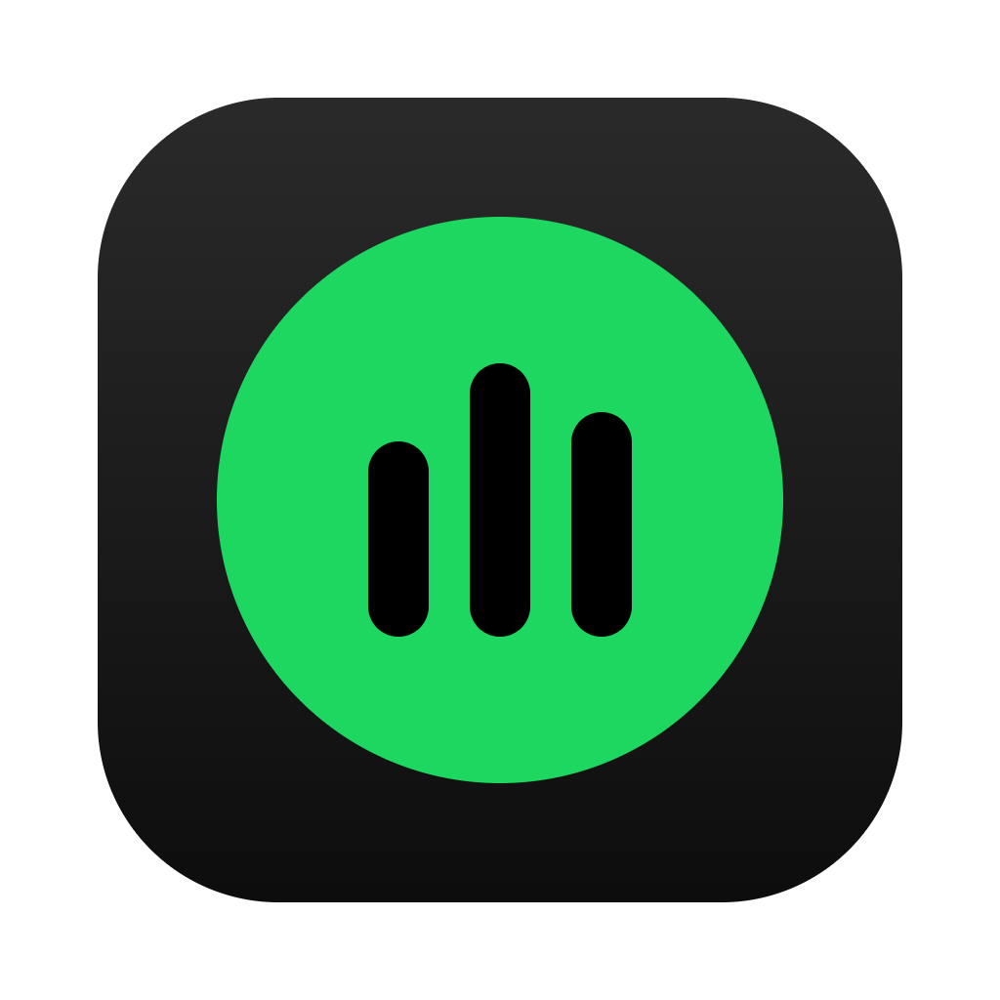
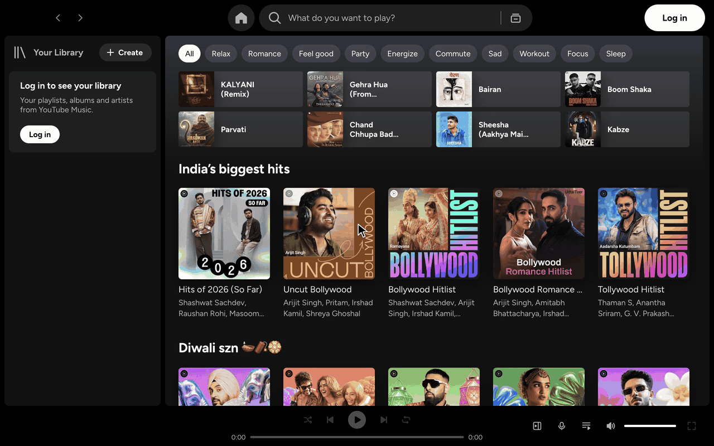
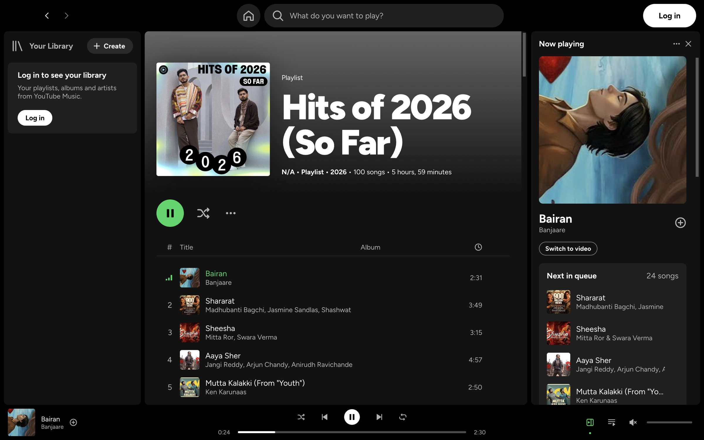
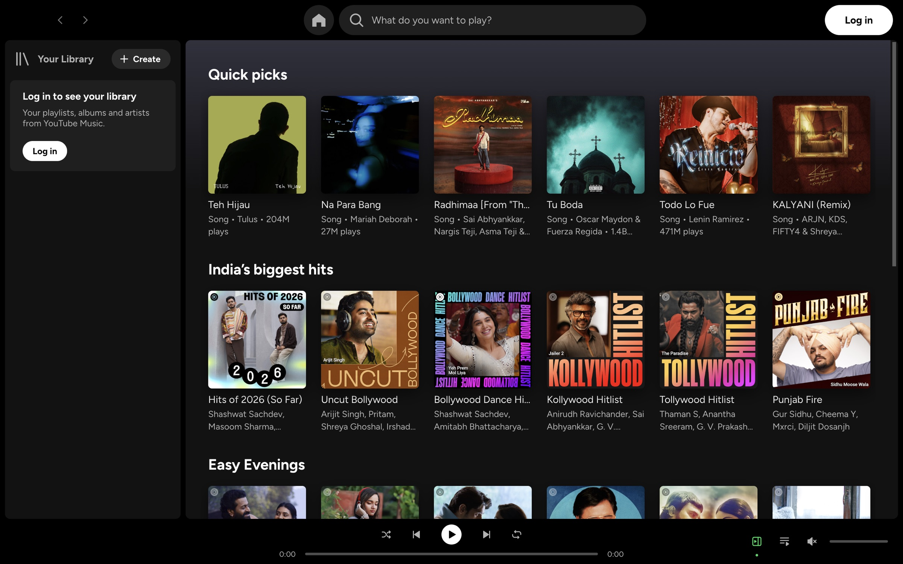
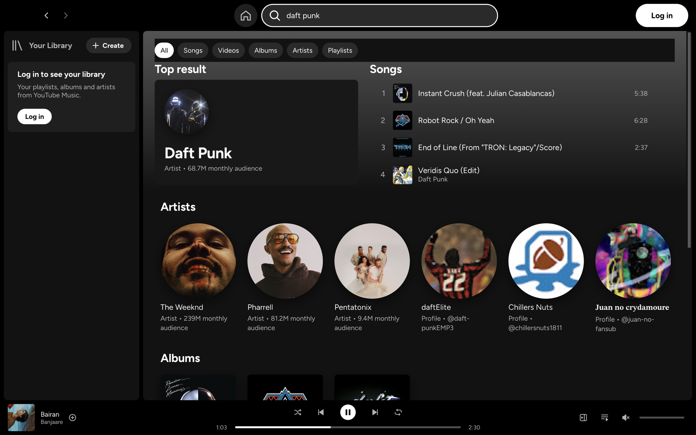
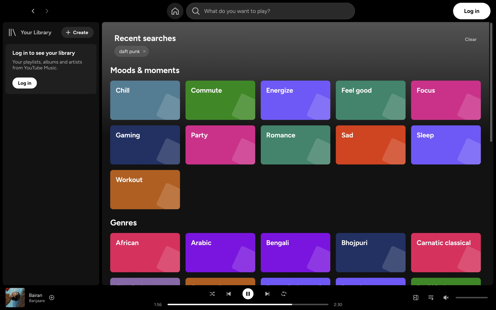
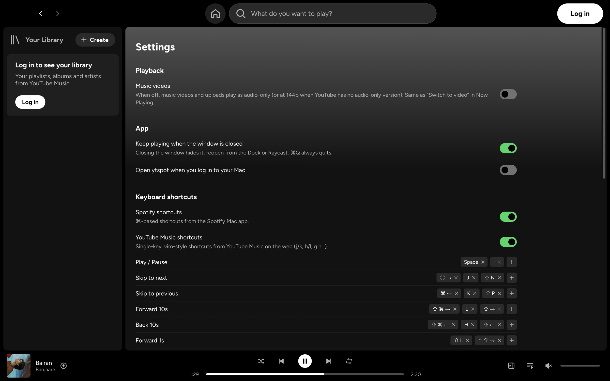
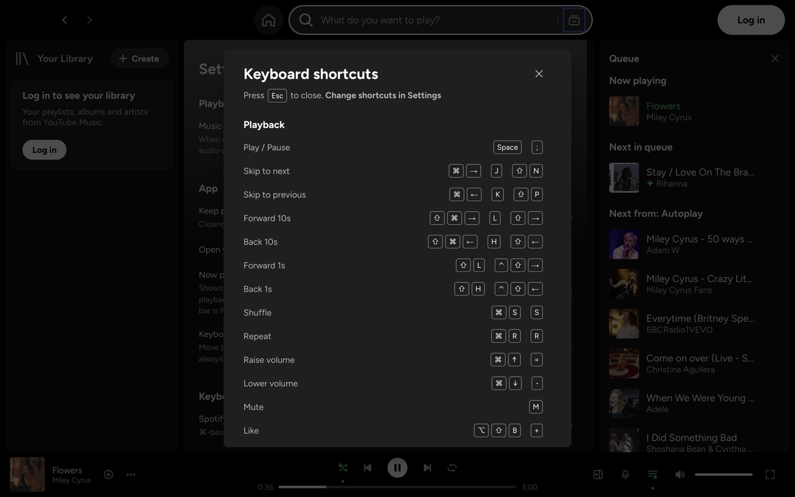

<div align="center">



# ytspot

**YouTube Music for Mac, with a Spotify-style UI.**

An open-source macOS desktop client for YouTube Music. It looks and handles like the Spotify Mac app: the same layout, keyboard shortcuts, Now Playing panel and queue. The music comes from your YouTube Music account.

[](https://github.com/Chaitanya-Shahare/ytspot/releases/latest)


[](LICENSE)
[](https://github.com/Chaitanya-Shahare/ytspot/stargazers)



<sub>`q` opens the queue · `j`/`k` next/previous · drag to reorder · `g h` Home</sub>

</div>

## Why

YouTube Music has the catalogue, but its desktop experience is a browser tab. Spotify has the best desktop app, but not your music. ytspot puts the Spotify UI on top of YouTube Music.

The UI is a separate React app; it is not a restyle of the YouTube Music website. Its colours, spacing, corner radii and control sizes come from the Spotify Mac app's own design tokens. Playback runs in a hidden YouTube Music player, so Premium, ad-free listening, radio and autoplay behave exactly as they do on music.youtube.com.

## Features

- **Spotify layout:** Your Library sidebar, Home, Search with Browse all, and album, artist and playlist pages. The Now Playing panel holds the full queue.
- **Full queue control:** drag and drop to reorder the queue and the Autoplay list, jump to any track, or remove tracks.
- **Song menus** on every row (click "⋯" or right-click): add to playlist, play next, add to queue, like, go to song radio, artist or album, copy link.
- **Two shortcut schemes:** Spotify's ⌘ shortcuts and YouTube Music's vim-style keys (`j`/`k`, `h`/`l`, `g h`, `/`). Both are on by default and don't collide. You can rebind any key, including two-key sequences, in Settings.
- **Audio-only by default:** songs stream without the video. Turn on **Switch to video** to watch the music video inside the Now Playing panel.
- **Native macOS integration:** Control Center / Now Playing widget, media keys, and a full menu bar (Playback, View, Window). Closing the window keeps the music playing, like Spotify.
- **All YouTube Music settings** in one Settings page: audio quality, Restricted Mode, dynamic queue, history, language and location.
- **Light on resources:** about 2% CPU and 250–300 MB of memory while playing with the window closed, and close to zero CPU when paused. Home appears in about 0.9 s from cache.

<table>
  <tr>
    <td></td>
    <td></td>
  </tr>
  <tr>
    <td align="center">Now Playing and queue</td>
    <td align="center">Home</td>
  </tr>
  <tr>
    <td></td>
    <td></td>
  </tr>
  <tr>
    <td align="center">Search</td>
    <td align="center">Browse all</td>
  </tr>
  <tr>
    <td></td>
    <td></td>
  </tr>
  <tr>
    <td align="center">Settings and shortcut editor</td>
    <td align="center">Keyboard shortcuts (⌘/)</td>
  </tr>
</table>

<sub>Screenshots are from a signed-out guest session. Sign in to see your library, Liked Songs and playlists in the sidebar.</sub>

## Install

**Homebrew** (recommended):

```bash
brew install --cask chaitanya-shahare/formulae/ytspot
```

**Manual:**

1. Download `ytspot-mac-arm64.zip` from the [latest release](https://github.com/Chaitanya-Shahare/ytspot/releases/latest), unzip it, and move `ytspot.app` to `/Applications`.
2. The app isn't notarized by Apple yet, so macOS blocks it on first launch. Clear the quarantine flag once (Homebrew does this for you):
   ```bash
   xattr -dr com.apple.quarantine /Applications/ytspot.app
   ```

Then open ytspot and click **Log in** at the top right.

Requires macOS 13+ on Apple Silicon. Intel Macs, Windows and Linux are untested; see [Build from source](#build-from-source).

## Signing in: read this first

ytspot signs you in through Google's normal sign-in page, opened in a small window. Google limits sign-in from embedded browsers, so a few things behave differently from a regular browser:

- **Passkeys don't work.** If Google offers a passkey, choose **Try another way** and use your password plus the prompt on your phone. Google only allows passkeys for apps it has approved, and Electron doesn't support the phone/QR passkey flow yet ([electron#53733](https://github.com/electron/electron/pull/53733)).
- **You may land on your Google Account page** instead of YouTube Music after "Try another way". ytspot detects this, finishes the YouTube Music sign-in on its own and closes the window. If your library still doesn't appear, close the sign-in window and click **Log in** again. It usually won't ask for your password again.
- **You only sign in once.** The session is saved in `~/Library/Application Support/ytspot` and survives restarts until Google signs you out.
- **YouTube Music Premium is recommended.** Without Premium, YouTube plays ads between songs, just as on the website.
- **Google may still block some accounts** with "Couldn't sign you in: this browser or app may not be secure". If that happens, please [open an issue](https://github.com/Chaitanya-Shahare/ytspot/issues).

You can use ytspot without signing in to browse, search and play. Your library, likes and playlists need an account.

## Keyboard shortcuts

Press **⌘/** or **?** in the app for the full list. Change any of them in **Settings (⌘,) → Keyboard shortcuts**.

| Action | Spotify style | YouTube Music style |
|---|---|---|
| Play / pause | `Space` | `Space` · `;` |
| Next / previous | `⌘→` / `⌘←` | `j` / `k` |
| Seek ±10 s | `⇧⌘→` / `⇧⌘←` | `l` / `h` |
| Volume up / down | `⌘↑` / `⌘↓` | `=` / `-` |
| Shuffle / repeat | `⌘S` / `⌘R` | `s` / `r` |
| Like | `⌥⇧B` | `+` |
| Search | `⌘L` · `⌘K` | `/` |
| Home / Explore / Library | `⌥⇧H` | `g h` / `g e` / `g l` |
| Queue | `⌥⇧Q` | `q` |
| Settings | `⌘,` | `g ,` |

## How it works

```
┌──────────────── ytspot ─────────────────┐
│  React UI (renderer)                    │  Spotify-style UI, shortcuts, queue
│        │ IPC                            │
│  Main process ── youtubei.js ───────────┼─▶ YouTube Music InnerTube API (browse, search, library)
│        │                                │
│  Hidden music.youtube.com player ───────┼─▶ YouTube's own player streams the audio
└─────────────────────────────────────────┘
```

- **Data:** [youtubei.js](https://github.com/LuanRT/YouTube.js) calls YouTube Music's InnerTube API from the main process, using your session cookies.
- **Playback:** a hidden `music.youtube.com` window plays the audio. ytspot sends it commands and reads its state. YouTube's player handles stream deciphering, so playback doesn't break when YouTube changes its streaming internals.
- **macOS:** the player's MediaSession feeds Control Center and the media keys; the menu bar shows your current key bindings.

## Compared with other YouTube Music desktop apps

| | ytspot | [Pear Desktop](https://github.com/pear-devs/pear-desktop) | [YTMDesktop](https://github.com/ytmdesktop/ytmdesktop) | [Kaset](https://github.com/sozercan/kaset) |
|---|---|---|---|---|
| UI | Its own, Spotify-style | YouTube Music website | YouTube Music website | Native, Apple Music-style |
| Platforms | macOS | Windows, macOS, Linux | Windows, macOS, Linux | macOS |
| Stack | Electron + React | Electron | Electron | Swift / SwiftUI |
| Keyboard shortcuts | Spotify + YouTube Music (vim), rebindable | YouTube Music | YouTube Music | Its own |
| Extras | Queue and autoplay in the side panel | 40+ plugins | Discord, Last.fm | Apple Intelligence features |

Choose **Pear Desktop** for plugins and Windows/Linux support. Choose **Kaset** for a fully native Swift app. Choose **ytspot** if you want YouTube Music to feel like Spotify.

## Build from source

Needs Node.js 22+ and macOS.

```bash
git clone https://github.com/Chaitanya-Shahare/ytspot.git
cd ytspot
npm install
npm run dev        # hot-reload dev mode
npm run dist       # builds dist/mac-arm64/ytspot.app
codesign --force --deep -s - dist/mac-arm64/ytspot.app
ditto dist/mac-arm64/ytspot.app /Applications/ytspot.app
```

To try a build next to an installed copy without touching it, give it its own profile. `YTSPOT_MUTE=1` silences playback:

```bash
npm run build
YTSPOT_PROFILE=/tmp/ytspot-test YTSPOT_MUTE=1 npx electron .
```

That profile has its own sign-in, never reads the installed app's keychain entry, leaves the media keys alone, and opens without taking focus.

Project layout:

| Path | What's there |
|---|---|
| `src/main/api.ts` | YouTube Music data via youtubei.js |
| `src/main/player.ts` | Hidden player window, sign-in, playback commands |
| `src/main/lyrics.ts` | Synced lyrics (LRCLIB) with YouTube Music's lyrics as fallback |
| `src/main/menu.ts` | macOS menu bar |
| `src/renderer/src/` | React UI: views, components, styles |
| `src/shared/shortcuts.ts` | Default key bindings for both schemes |

## Contributing

Issues and pull requests are welcome, especially for:

- Windows and Linux support
- Intel Mac builds
- Lyrics
- Last.fm scrobbling and Discord Rich Presence

If ytspot is useful to you, a ⭐ helps other people find it.

## Disclaimer

ytspot is an unofficial, personal project. It is not affiliated with, endorsed by or sponsored by Spotify AB, YouTube or Google LLC. "Spotify", "YouTube" and "YouTube Music" are trademarks of their owners. ytspot ships no Spotify code, fonts or icons: the font is [Figtree](https://fonts.google.com/specimen/Figtree) and the icons are drawn from scratch. It uses an unofficial YouTube API that can change without notice. Use it with your own account, at your own risk, under YouTube's Terms of Service.

## License

[MIT](LICENSE) © Chaitanya Shahare
