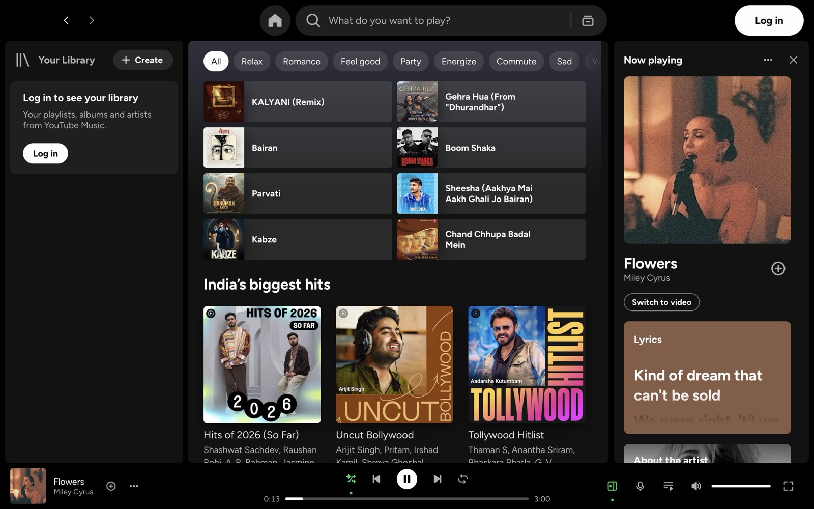
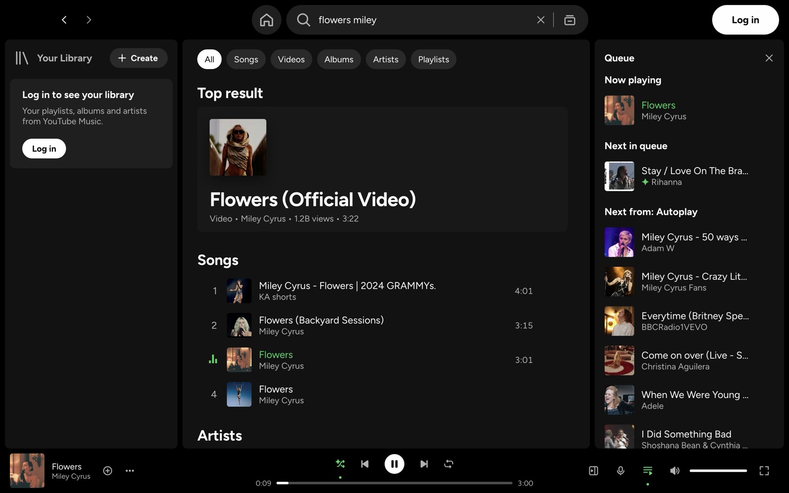
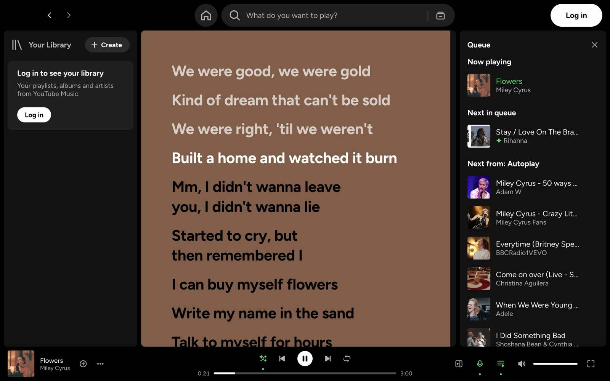
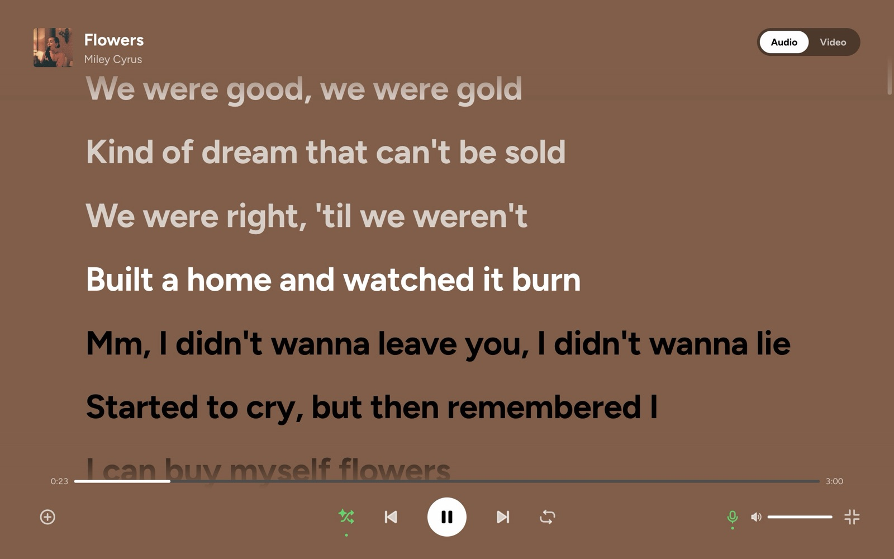
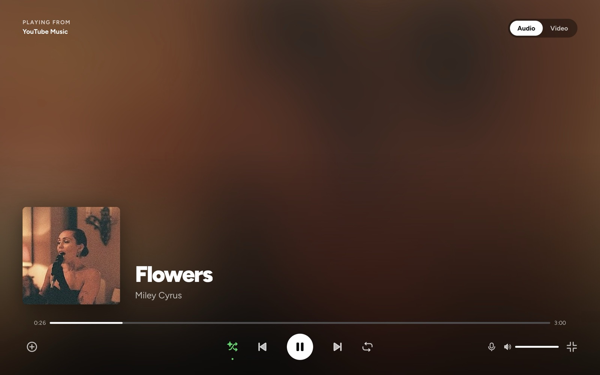
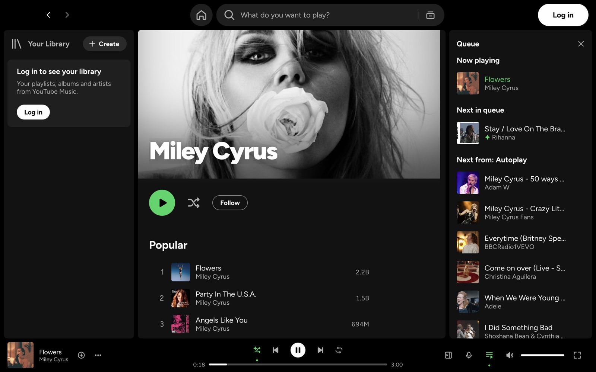

<div align="center">


# ytspot

**YouTube Music for Mac, with a Spotify-style UI.**

A free, open-source macOS desktop app for YouTube Music. It looks and works like the Spotify Mac app (same layout, keyboard shortcuts, Now Playing panel, queue, lyrics and full screen) and plays your YouTube Music library, without ads.

[](https://github.com/Chaitanya-Shahare/ytspot/releases/latest)
[](https://github.com/Chaitanya-Shahare/ytspot/releases)


[](LICENSE)
[](https://github.com/Chaitanya-Shahare/ytspot/stargazers)

[Install](#install) · [Features](#features) · [Screenshots](#screenshots) · [Shortcuts](#keyboard-shortcuts) · [FAQ](#faq) · [Build from source](#build-from-source)

</div>

## Install

```bash
brew install --cask chaitanya-shahare/formulae/ytspot
```

Then open **ytspot** and click **Log in** at the top right. That's it.

<details>
<summary><b>Without Homebrew</b></summary>

1. Download `ytspot-mac-arm64.zip` from the [latest release](https://github.com/Chaitanya-Shahare/ytspot/releases/latest), unzip it, and move `ytspot.app` to `/Applications`.
2. The app isn't notarized by Apple yet, so macOS blocks it on first launch. Clear the quarantine flag once (Homebrew does this for you):
   ```bash
   xattr -dr com.apple.quarantine /Applications/ytspot.app
   ```

</details>

**Update:** `brew upgrade --cask ytspot` · **Uninstall:** `brew uninstall --cask ytspot`

Requires macOS 13+ on Apple Silicon. Intel Macs, Windows and Linux are untested; see [Build from source](#build-from-source).

## Demo

<div align="center">


<sub>Search · play · Queue · Smart Shuffle · synced lyrics · full-screen lyrics and artwork · `j` next track · `g h` Home</sub>

</div>

## Why

YouTube Music has the catalogue, but its desktop experience is a browser tab. Spotify has the best desktop app, but not your music. ytspot puts the Spotify UI on top of YouTube Music.

The UI is a separate React app, not a restyle of the YouTube Music website. Its colours, spacing, corner radii and control sizes come from the Spotify Mac app's design tokens. Playback runs in a hidden YouTube Music player, so Premium, radio and autoplay behave exactly as they do on music.youtube.com.

## Features

### Listening

- **No ads, with or without Premium.** Ads are stripped from YouTube Music's player responses before the player sees them, and ad requests are blocked. If one slips through anyway, it's muted and fast-forwarded.
- **Audio-only by default.** Songs stream without the video. Turn on **Switch to video** to watch the music video in the Now Playing panel.
- **Synced lyrics**, Spotify style: the current line is highlighted as the song plays, and clicking a line seeks to it. A lyrics card in the Now Playing panel follows along. Lyrics come from [LRCLIB](https://lrclib.net), with YouTube Music's own lyrics as a fallback.
- **Full screen, three ways:** the artwork as in Spotify, the music video filling the screen, or full-screen synced lyrics. The controls fade out after 3 seconds without mouse movement.
- **Shuffle and Smart Shuffle.** The shuffle button cycles off → Shuffle → Smart Shuffle. Smart Shuffle mixes a recommendation in after every 3 songs, marked with a ✦ in the queue. Turning shuffle off restores the original order.
- Keeps playing past YouTube Music's "Continue watching?" prompt.

### Spotify-style UI

- **The full Spotify layout:** Your Library sidebar, Home with mood chips (Relax, Workout, Focus…), Search, Browse all, Explore, and album, artist and playlist pages with sticky headers.
- **Now Playing panel:** artwork, where playback started, the lyrics card, About the artist and what's up next.
- **Queue panel:** drag and drop to reorder the queue and the Autoplay list, jump to any track, or remove tracks.
- **Song menus** on every row ("⋯" or right-click): add to playlist, play next, add to queue, like, go to song radio, artist or album, copy link.
- **Search** with filter chips (Songs, Videos, Albums, Artists, Playlists) and recent searches.
- Resizable sidebars, a collapsible library, back/forward that restores your scroll position, and Spotify-style tooltips and toasts.

### Library and playlists

- **Your Library** in Grid, List or Compact view, with search, sort and pinning. Save albums and other people's playlists to it.
- **Playlist editing:** create, delete, and edit the name, description, privacy and cover image, all saved to YouTube Music.
- The **+** button saves to Liked Songs, then opens an **Add to playlist** popover. Duplicate adds ask first.
- **Recommended songs** and an inline song search under your own playlists, like Spotify.
- **Search in playlist** (⌘F) with sort by title, artist, album or duration.

### Keyboard

- **Two shortcut schemes:** Spotify's ⌘ shortcuts and YouTube Music's vim-style keys (`j`/`k`, `h`/`l`, `g h`, `/`). Both are on by default and don't collide.
- **Rebind any key** in Settings, including two-key sequences like `g h`.
- Track lists work from the keyboard: arrow keys to move, Enter to play. Press **⌘/** or **?** for the full list.

### macOS integration

- **Control Center** Now Playing widget and **media keys**.
- **Menu bar player:** the current song in the macOS menu bar, with play/pause, next, previous and like. Show the song, the artist, both, or just an icon.
- A full **app menu bar** (Playback, View, Window) that shows your current key bindings.
- **Closing the window keeps the music playing**, like Spotify. The interface is unloaded to free memory and reopens from the Dock.
- Optionally open ytspot when you log in to your Mac.

### Settings

- All **YouTube Music settings** in one Settings page: audio quality, Restricted Mode, dynamic queue, history, language and location.

## Screenshots

<table>
  <tr>
    <td></td>
    <td></td>
  </tr>
  <tr>
    <td align="center">Home and Now Playing</td>
    <td align="center">Search and the queue, with Smart Shuffle (✦)</td>
  </tr>
  <tr>
    <td></td>
    <td></td>
  </tr>
  <tr>
    <td align="center">Synced lyrics</td>
    <td align="center">Full-screen lyrics</td>
  </tr>
  <tr>
    <td></td>
    <td></td>
  </tr>
  <tr>
    <td align="center">Full-screen artwork</td>
    <td align="center">Artist page</td>
  </tr>
  <tr>
    <td></td>
    <td></td>
  </tr>
  <tr>
    <td align="center">Settings</td>
    <td align="center">Keyboard shortcuts (⌘/)</td>
  </tr>
</table>

<sub>Screenshots are from a signed-out guest session. Sign in to see your library, Liked Songs and playlists in the sidebar.</sub>

## Signing in

ytspot signs you in through Google's normal sign-in page, opened in a small window. You only sign in once: the session is saved in `~/Library/Application Support/ytspot` and survives restarts. Google limits sign-in from embedded browsers, so a few things behave differently from a regular browser:

- **Passkeys don't work.** If Google offers a passkey, choose **Try another way** and use your password plus the prompt on your phone. Google only allows passkeys for apps it has approved, and Electron doesn't support the phone/QR passkey flow yet ([electron#53733](https://github.com/electron/electron/pull/53733)).
- **You may land on your Google Account page** instead of YouTube Music after "Try another way". ytspot detects this, finishes the YouTube Music sign-in on its own and closes the window. If your library still doesn't appear, close the sign-in window and click **Log in** again. It usually won't ask for your password again.
- **Google may still block some accounts** with "Couldn't sign you in: this browser or app may not be secure". If that happens, please [open an issue](https://github.com/Chaitanya-Shahare/ytspot/issues).

You can use ytspot without signing in to browse, search and play. Your library, likes and playlists need an account.

## Keyboard shortcuts

Press **⌘/** or **?** in the app for the full list. Change any of them in **Settings (⌘,) → Keyboard shortcuts**.

| Action | Spotify style | YouTube Music style |
|---|---|---|
| Play / pause | `Space` | `Space` · `;` |
| Next / previous | `⌘→` / `⌘←` | `j` / `k` |
| Seek ±10 s | `⇧⌘→` / `⇧⌘←` | `l` / `h` |
| Volume up / down | `⌘↑` / `⌘↓` | `=` / `-` |
| Shuffle / repeat | `⌘S` / `⌘R` | `s` / `r` |
| Like | `⌥⇧B` | `+` |
| Search | `⌘L` · `⌘K` | `/` |
| Home / Explore / Library | `⌥⇧H` | `g h` / `g e` / `g l` |
| Queue | `⌥⇧Q` | `q` |
| Search in playlist | `⌘F` | `⌘F` |
| Settings | `⌘,` | `g ,` |

## How it works

```
┌──────────────── ytspot ─────────────────┐
│  React UI (renderer)                    │  Spotify-style UI, shortcuts, queue
│        │ IPC                            │
│  Main process ── youtubei.js ───────────┼─▶ YouTube Music InnerTube API (browse, search, library)
│        │                                │
│  Hidden music.youtube.com player ───────┼─▶ YouTube's own player streams the audio
└─────────────────────────────────────────┘
```

- **Data:** [youtubei.js](https://github.com/LuanRT/YouTube.js) calls YouTube Music's InnerTube API from the main process, using your session cookies.
- **Playback:** a hidden `music.youtube.com` window plays the audio. ytspot sends it commands and reads its state. YouTube's player handles stream deciphering, so playback doesn't break when YouTube changes its streaming internals.
- **Lyrics:** synced lyrics from [LRCLIB](https://lrclib.net), falling back to YouTube Music's lyrics.
- **macOS:** the player's MediaSession feeds Control Center and the media keys; the menu bar shows your current key bindings.

## Compared with other YouTube Music desktop apps

| | ytspot | [Pear Desktop](https://github.com/pear-devs/pear-desktop) | [YTMDesktop](https://github.com/ytmdesktop/ytmdesktop) | [Kaset](https://github.com/sozercan/kaset) |
|---|---|---|---|---|
| UI | Its own, Spotify-style | YouTube Music website | YouTube Music website | Native, Apple Music-style |
| Platforms | macOS | Windows, macOS, Linux | Windows, macOS, Linux | macOS |
| Stack | Electron + React | Electron | Electron | Swift / SwiftUI |
| Keyboard shortcuts | Spotify + YouTube Music (vim), rebindable | YouTube Music | YouTube Music | Its own |
| Extras | Synced lyrics, Smart Shuffle, no ads, menu bar player | 40+ plugins | Discord, Last.fm | Apple Intelligence features |

Choose **Pear Desktop** for plugins and Windows/Linux support. Choose **Kaset** for a fully native Swift app. Choose **ytspot** if you want YouTube Music to look and feel like Spotify.

## FAQ

**Is there a YouTube Music desktop app for Mac?**
Google doesn't make one; music.youtube.com is a website. ytspot is a free, open-source YouTube Music desktop app for macOS, with a Spotify-style interface, media keys and Control Center support.

**Do I need YouTube Music Premium?**
No. ytspot plays without ads either way. Premium features such as higher audio quality work if your account has them.

**Can I use Spotify playlists?**
No. ytspot only looks like Spotify; your music, library and playlists come from YouTube Music.

**Does it work without signing in?**
Yes. You can browse, search and play as a guest. Sign in to see your library, likes and playlists.

**Does it work on Intel Macs, Windows or Linux?**
Releases are built for Apple Silicon Macs only. Other platforms are untested, but you can try [building from source](#build-from-source).

## Build from source

Needs Node.js 22+ and macOS.

```bash
git clone https://github.com/Chaitanya-Shahare/ytspot.git
cd ytspot
npm install
npm run dev        # hot-reload dev mode
npm run dist       # builds dist/mac-arm64/ytspot.app
codesign --force --deep -s - dist/mac-arm64/ytspot.app
ditto dist/mac-arm64/ytspot.app /Applications/ytspot.app
```

To try a build next to an installed copy without touching it, give it its own profile. `YTSPOT_MUTE=1` silences playback:

```bash
npm run build
YTSPOT_PROFILE=/tmp/ytspot-test YTSPOT_MUTE=1 npx electron .
```

That profile has its own sign-in, never reads the installed app's keychain entry, leaves the media keys alone, and opens without taking focus.

Project layout:

| Path | What's there |
|---|---|
| `src/main/api.ts` | YouTube Music data via youtubei.js |
| `src/main/player.ts` | Hidden player window, sign-in, playback commands |
| `src/main/adblock.ts` | Ad removal from player responses |
| `src/main/lyrics.ts` | Synced lyrics (LRCLIB) with YouTube Music's lyrics as fallback |
| `src/main/menu.ts` · `src/main/tray.ts` | macOS menu bar and menu bar player |
| `src/renderer/src/` | React UI: views, components, styles |
| `src/shared/shortcuts.ts` | Default key bindings for both schemes |

## Contributing

Issues and pull requests are welcome, especially for:

- Windows and Linux support
- Intel Mac builds
- Last.fm scrobbling and Discord Rich Presence

If ytspot is useful to you, a ⭐ helps other people find it.

## Disclaimer

ytspot is an unofficial, personal project. It is not affiliated with, endorsed by or sponsored by Spotify AB, YouTube or Google LLC. "Spotify", "YouTube" and "YouTube Music" are trademarks of their owners. ytspot ships no Spotify code, fonts or icons: the font is [Figtree](https://fonts.google.com/specimen/Figtree) and the icons are drawn from scratch. It uses an unofficial YouTube API that can change without notice. Use it with your own account, at your own risk, under YouTube's Terms of Service.

## License

[MIT](LICENSE) © Chaitanya Shahare
